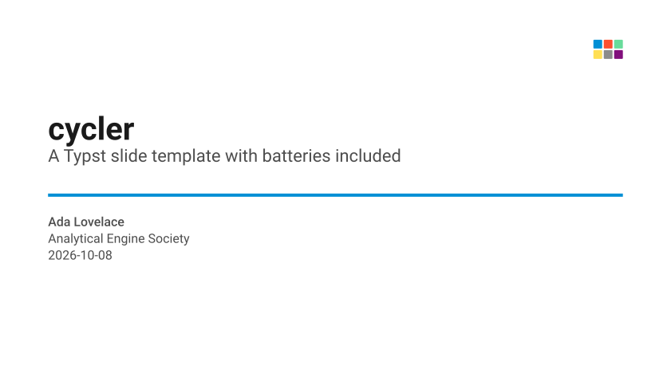
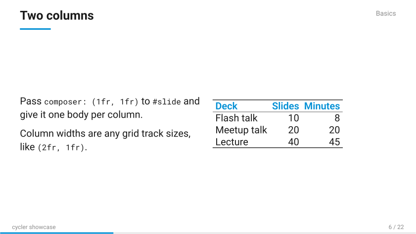
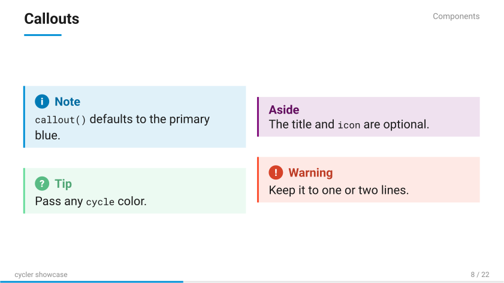
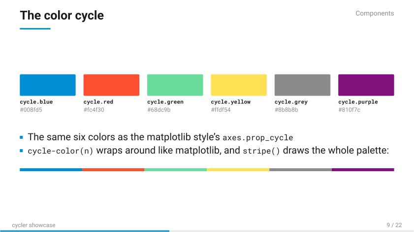
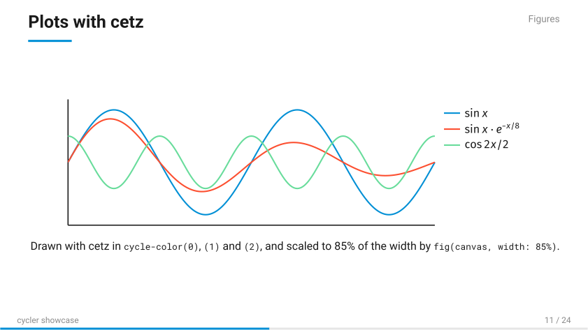
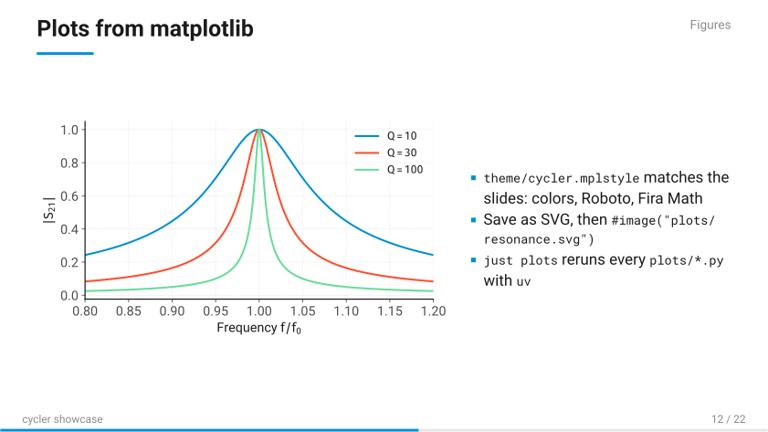
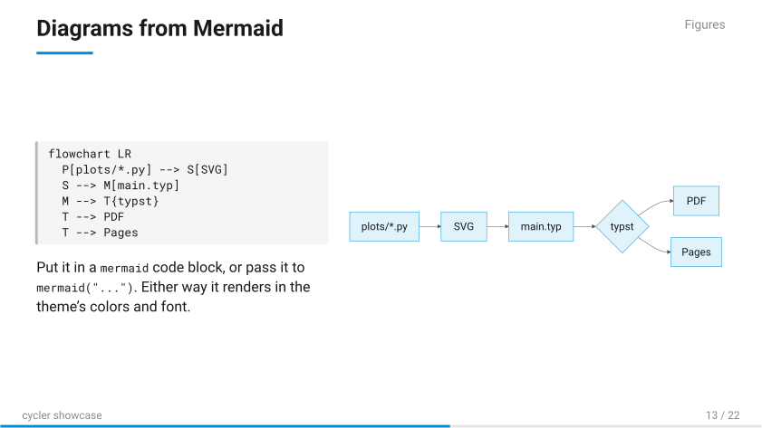
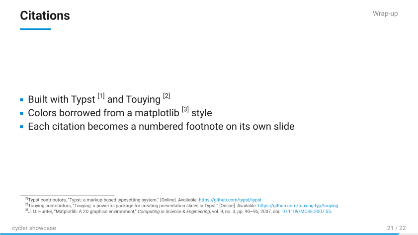

# typst-touying-template

[](https://github.com/nikosavola/typst-touying-template/actions/workflows/ci.yml)
[](https://github.com/nikosavola/typst-touying-template/actions/workflows/test_copier.yml)
[](https://typst.app)
[](https://github.com/touying-typ/touying)

A [Copier](https://copier.readthedocs.io) template for [Typst](https://typst.app) slide decks built with
[Touying](https://github.com/touying-typ/touying). It ships `cycler`, a small theme built around the modified
fivethirtyeight color cycle from a matplotlib style, plus the tooling around it: a `justfile`, pre-commit hooks, CI,
vendored fonts, and Typst/Touying skills for coding agents.



## Creating a new presentation

```sh
uvx copier copy gh:nikosavola/typst-touying-template my-talk
cd my-talk
git init
just agent-skills        # optional, see below
just pre-commit-install
just build
```

Copier asks for a project name, title, optional subtitle, author, optional event, and sans (Roboto) or serif (Libertinus
Serif) text. You get a standalone repo with a starter `main.typ` to edit. Later, `uvx copier update` inside it pulls in
template fixes without touching your slides.

| Recipe              | What it does                                            |
| ------------------- | ------------------------------------------------------- |
| `just build`        | Compile the deck to a PDF in `build/`                   |
| `just watch`        | Recompile on save                                       |
| `just preview`      | Render every slide to `build/preview-*.png`             |
| `just build-pptx`   | Optional PPTX export, one image per slide, via `uvx`    |
| `just site`         | PDF plus an `index.html`, ready for GitHub Pages        |
| `just plots`        | Rerun every `plots/*.py` matplotlib script with `uv`    |
| `just check-pdf`    | Validate the PDF as PDF/A-2b with veraPDF (Docker)      |
| `just format`       | Format Typst sources with typstyle                      |
| `just pre-commit`   | Run all hooks with [prek](https://github.com/j178/prek) |
| `just agent-skills` | Add the agent skills as git submodules                  |

### Publishing to GitHub Pages

Answer yes to the GitHub Pages question and pick a branch. Every push to that branch then runs `just site` and deploys
the PDF with a small `index.html` around it. Before the first run, set **Settings → Pages → Source** to "GitHub
Actions", and if the branch isn't the default one, allow it under **Settings → Environments → github-pages**.

### Or: "Use this template" on GitHub

GitHub's template button copies this repo as-is, without running Copier. So you get the template itself: no rendered
`main.typ` (`just build` builds the demo deck instead), no `.copier-answers.yml` for `copier update`, and the
agent-skill submodules come through as `.gitmodules` only. That's handy for hacking on the theme itself; for a new deck,
use Copier above. `just agent-skills` restores the submodules in either case.

## The cycler theme

```typst
#import "@preview/touying:0.7.4": *
#import "theme/cycler.typ": *

#show: cycler-theme.with(
  aspect-ratio: "16-9",
  // font: "Libertinus Serif",
  config-info(title: [Title], subtitle: [Subtitle], author: [Me], date: datetime.today()),
)

#title-slide()

= A section

== A slide
- Content, with *highlights* in the primary blue
```

- Colors: the cycle comes from matplotlib's
  [fivethirtyeight style](https://matplotlib.org/stable/gallery/style_sheets/fivethirtyeight.html). Blue `#008fd5`, red
  `#fc4f30`, grey `#8b8b8b` and purple `#810f7c` are taken as is. Slots 3 and 4 (gold `#e5ae38`, green `#6d904f`) are
  swapped for a brighter green `#68dc9b` and yellow `#ffdf54`.
- Slides: `title-slide` (with an optional `logo`), `slide`, `focus-slide`, `image-slide` for a full-bleed photo, and a
  numbered section slide per `=` heading. Section numbers step through the cycle.
- Helpers: `cycle` (the six colors by name), `cycle-color(n)`, `stripe()` for the full palette, `section-outline()` for
  an agenda slide, and `callout(color:, title:, icon:)[..]`, where `icon: "!"` draws a round badge without an icon font.
  `===` headings and `#quote(block: true)` are styled too.
- Theme options: `font`, `mono-font`, `math-font`, `footer`, `footer-right`, `header-right`, `progress-bar`,
  `bibliography`.
- Citations: pass `bibliography: bibliography(title: none, "refs.bib")` and cite with `@key`. Each citation becomes a
  numbered footnote on its slide; `#magic.bibliography(title: none)` can also list them all on one slide. `bibtex-tidy`
  keeps `.bib` files formatted.
- Plots: `theme/cycler.mplstyle` makes matplotlib figures match the slides (colors, Roboto, Fira Math). Put scripts in
  `plots/`, save SVG, and `#image()` it; `just plots` reruns them. `example/plots/resonance.py` is a complete example,
  with its dependencies inline so `uv` needs no project setup.
- Diagrams: a `mermaid` code block, or `mermaid("...")`, renders a [Mermaid](https://mermaid.js.org) diagram in the
  cycle colors and deck font. [`merman`](https://github.com/Latias94/merman) does it natively in Typst, so the build
  needs no browser or Node.js. Pass `profile:` or any other `merman` parameter to override `mermaid-profile`.
- PDFs are built as PDF 1.7 / PDF/A-2b (override with `PDF_STANDARD`), with title, author, subject and keywords in both
  the document info and XMP metadata. CI checks conformance with veraPDF.
- Roboto, Roboto Mono and Fira Math are vendored in `fonts/` (OFL), so decks render the same everywhere. Compile with
  `--font-path fonts`, which `just build` does for you.

## Agent skills

`.agents/skills/` holds skills in the tool-agnostic [Agent Skills](https://agentskills.io) layout, and `.claude/skills`
links to the same place for Claude Code:

- `typst-author` and `touying-author` from [apcamargo/typst-skills](https://github.com/apcamargo/typst-skills)
- `seaslides-typst-slides-skill` from [touying-typ/seaslides](https://github.com/touying-typ/seaslides)

They're git submodules under `.agents/vendor/`, symlinked into `.agents/skills/`. Clone this repo with
`--recurse-submodules`, or run `just agent-skills` afterwards. Generated projects don't copy the submodules;
`just agent-skills` adds them there after `git init`. In a colocated jj repo, commit the new submodules with `git`,
since jj doesn't track submodules.

## Showcase deck

`example/showcase.typ` walks through everything the theme does: an outline, text, typography and quotes, reveals,
columns, callouts, the color cycle, a cetz plot, a matplotlib figure and a Mermaid diagram in the cycle colors, a
full-bleed photo, tables, code next to its output, math, citations as footnotes, speaker notes, and QR codes. In this
repo, `just build` builds it, since there's no `main.typ` here.

 
 




The screenshots are vector SVGs, cut from the built PDF by `just readme-images` (needs `pdftocairo` from poppler).

For a real deck made with this template, see the
[`presentation` branch](https://github.com/nikosavola/electrolux-ac-infrared/tree/presentation) of
electrolux-ac-infrared, published at <https://nikosavola.github.io/electrolux-ac-infrared/>.

## License

MIT for this template. Fonts are under the SIL Open Font License 1.1; see `fonts/`.
