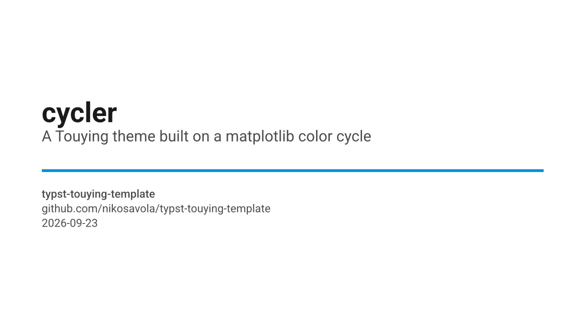
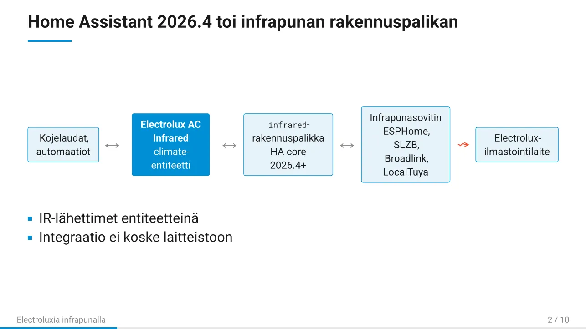
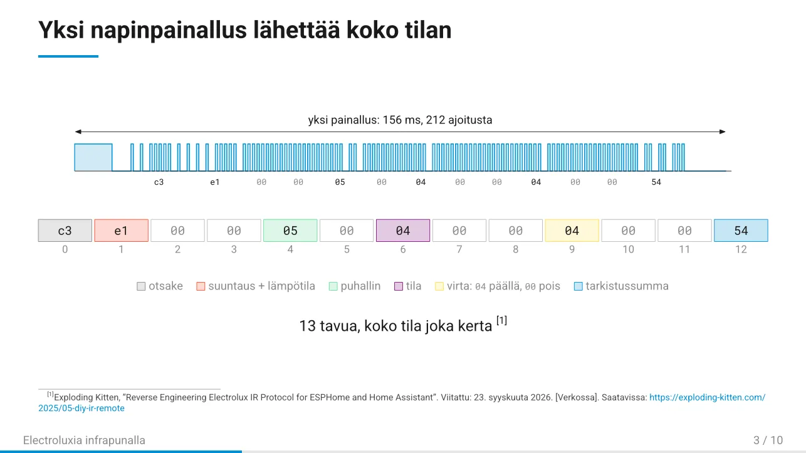
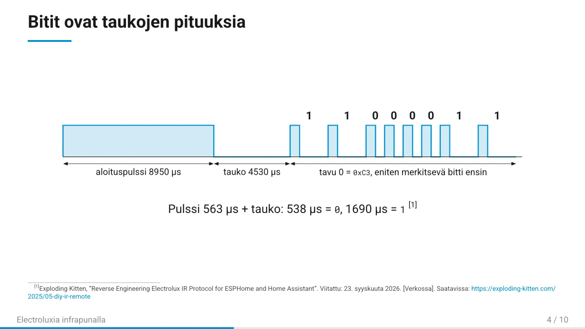
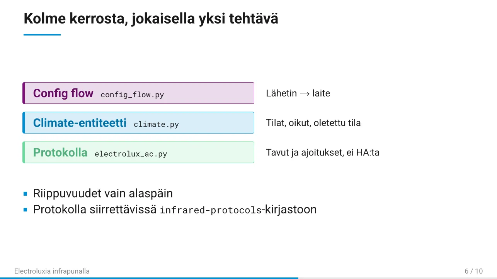
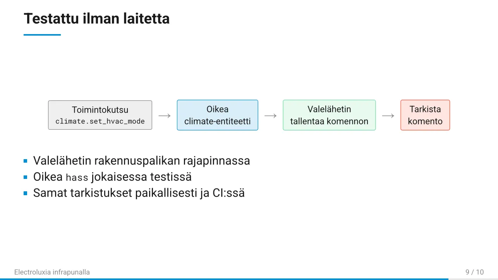

# typst-touying-template

[](https://github.com/nikosavola/typst-touying-template/actions/workflows/ci.yml)
[](https://github.com/nikosavola/typst-touying-template/actions/workflows/test_copier.yml)
[](https://typst.app)
[](https://github.com/touying-typ/touying)

A [Copier](https://copier.readthedocs.io) template for [Typst](https://typst.app) slide decks built with
[Touying](https://github.com/touying-typ/touying). It ships `cycler`, a small theme built around the modified
fivethirtyeight color cycle from a matplotlib style, plus the tooling around it: a `justfile`, pre-commit hooks, CI,
vendored fonts, and Typst/Touying skills for coding agents.



## Creating a new presentation

```sh
uvx copier copy gh:nikosavola/typst-touying-template my-talk
cd my-talk
git init
just agent-skills        # optional, see below
just pre-commit-install
just build
```

Copier asks for a project name, title, optional subtitle, author, optional event, and sans (Roboto) or serif (Libertinus
Serif) text. You get a standalone repo with a starter `main.typ` to edit. Later, `uvx copier update` inside it pulls in
template fixes without touching your slides.

| Recipe              | What it does                                            |
| ------------------- | ------------------------------------------------------- |
| `just build`        | Compile the deck to a PDF in `build/`                   |
| `just watch`        | Recompile on save                                       |
| `just preview`      | Render every slide to `build/preview-*.png`             |
| `just build-pptx`   | Optional PPTX export, one image per slide, via `uvx`    |
| `just format`       | Format Typst sources with typstyle                      |
| `just pre-commit`   | Run all hooks with [prek](https://github.com/j178/prek) |
| `just agent-skills` | Add the agent skills as git submodules                  |

### Or: "Use this template" on GitHub

GitHub's template button copies this repo as-is, without running Copier. So you get the template itself: no rendered
`main.typ` (`just build` builds the demo deck instead), no `.copier-answers.yml` for `copier update`, and the
agent-skill submodules come through as `.gitmodules` only. That's handy for hacking on the theme itself; for a new deck,
use Copier above. `just agent-skills` restores the submodules in either case.

## The cycler theme

```typst
#import "@preview/touying:0.7.4": *
#import "theme/cycler.typ": *

#show: cycler-theme.with(
  aspect-ratio: "16-9",
  // font: "Libertinus Serif",
  config-info(title: [Title], subtitle: [Subtitle], author: [Me], date: datetime.today()),
)

#title-slide()

= A section

== A slide
- Content, with *highlights* in the primary blue
```

- Slides: `title-slide`, `slide`, `focus-slide`, and a numbered section slide per `=` heading. Section numbers step
  through the cycle.
- Helpers: `cycle` (the six colors by name), `cycle-color(n)`, `stripe()` for the full palette, and
  `callout(color:, title:)[..]`.
- Theme options: `font`, `mono-font`, `footer`, `footer-right`, `header-right`, `progress-bar`, `bibliography`.
- Citations: pass `bibliography: bibliography(title: none, "refs.bib")` and cite with `@key`. Each citation becomes a
  numbered footnote on its slide; `#magic.bibliography(title: none)` can also list them all on one slide. `bibtex-tidy`
  keeps `.bib` files formatted.
- Roboto and Roboto Mono are vendored in `fonts/` (OFL), so decks render the same everywhere. Compile with
  `--font-path fonts`, which `just build` does for you.

## Agent skills

`.agents/skills/` holds skills in the tool-agnostic [Agent Skills](https://agentskills.io) layout, and `.claude/skills`
links to the same place for Claude Code:

- `typst-author` and `touying-author` from [apcamargo/typst-skills](https://github.com/apcamargo/typst-skills)
- `seaslides-typst-slides-skill` from [touying-typ/seaslides](https://github.com/touying-typ/seaslides)

They're git submodules under `.agents/vendor/`, symlinked into `.agents/skills/`. Clone this repo with
`--recurse-submodules`, or run `just agent-skills` afterwards. Generated projects don't copy the submodules;
`just agent-skills` adds them there after `git init`. In a colocated jj repo, commit the new submodules with `git`,
since jj doesn't track submodules.

## Demo deck

`example/electrolux-ir.typ` is a flash talk in Finnish, about 8 minutes plus questions, on building the
[Electrolux AC Infrared](https://github.com/nikosavola/electrolux-ac-infrared) Home Assistant integration: the
`infrared` building block, how the integration splits into layers, the design choices infrared forces, and how it's
tested without hardware. It sets `#set text(lang: "fi")`, which also localizes the citation footnotes. Sources are cited
as per-slide footnotes from `example/refs.bib`. The protocol figure is drawn by a Typst port of the encoder, pinned by
an `assert` to the Python encoder's output. In this repo, `just build` builds it, since there's no `main.typ` here.

 
 


## License

MIT for this template. Fonts are under the SIL Open Font License 1.1; see `fonts/`.
